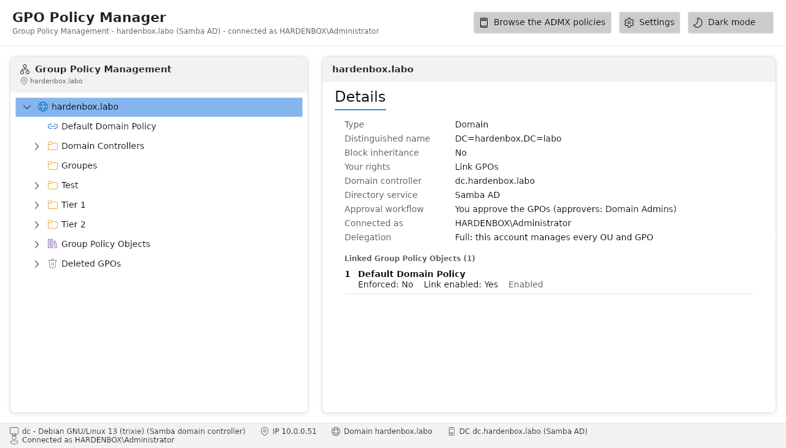

# HGPM

[](https://github.com/JM2K69/PSGPOTools/actions/workflows/ci.yml)
[](https://jm2k69.github.io/PSGPOTools/)

**HGPM** is a Group Policy management console, in the spirit of GPMC, written in
PowerShell 7 with an [Avalonia](https://avaloniaui.net/) interface. It runs on **Windows and
Linux**, and manages the GPOs of **Samba AD** and **Windows Active Directory** domains alike.
It was named PSGPOTools: the module is published on the PowerShell Gallery as `HGPM`.

**Documentation: <https://jm2k69.github.io/PSGPOTools/>** ([français](https://jm2k69.github.io/PSGPOTools/fr/))



## What it does

- **Group Policy Management view**: the domain, its OUs and their GPO links, the Group Policy
  Objects; create, link, delete and restore GPOs, with their status and security filtering.
- **Policy editor**: the administrative templates (ADMX/ADML), the security settings
  (`GptTmpl.inf`) and the Group Policy Preferences of a GPO, read from SYSVOL and saved there,
  its version and client-side extensions updated as GPMC does.
- **History**: backups with comments and labels, the differences between two versions, restore,
  a recycle bin, templates, and the drift of each GPO from its approved version.
- **Approval workflow**: Tier 1 technicians create GPOs that apply to nobody until a Tier 0
  approver approves them, on the rights of the domain only.
- **Delegation**: each technician sees and changes only what the domain lets their account
  manage.
- **Central configuration**: one file in the SYSVOL of the domain, the same for every console.

Everything the console does is also a PowerShell command (`Get-PSGPODirectory`, `New-PSGPO`,
`Backup-PSGPO`, `Approve-PSGPO`...): see the
[command reference](https://jm2k69.github.io/PSGPOTools/en/reference/commands/).

## Quick start

PowerShell **7.4 or later**, on Windows or Linux. From the repository:

```powershell
git clone https://github.com/JM2K69/PSGPOTools.git
cd PSGPOTools
pwsh -File CI/03_Build.ps1          # builds HGPM/HGPM.psm1 from Code/
Import-Module ./HGPM/HGPM.psd1
Show-GPOManagerAvalonia             # the domain of the computer, or -Server dc.example.com
```

The first time a window opens, the console downloads its Avalonia runtime from nuget.org, each
package checked against its pinned SHA-512. What each platform needs (RSAT on Windows; Kerberos,
`samba-tool`, `smbclient` and the SASL GSSAPI module on Linux) is in
[Installation](https://jm2k69.github.io/PSGPOTools/en/getting-started/installation/).

## Development

The sources are in `Code/` (classes, private and public functions); `CI/03_Build.ps1`
concatenates them into `HGPM/HGPM.psm1`, which is not versioned. The tests need
Pester 5.5+:

```powershell
pwsh -File CI/Invoke-Tests.ps1
```

The CI runs them on Windows and Linux (the window included, on Xvfb on Linux), and the tests that
write to a domain against a Samba AD DC. The architecture and the formats are described in the
[technical documentation](https://jm2k69.github.io/PSGPOTools/en/technical/architecture/); see
[contributing.md](contributing.md) to contribute, and [SECURITY.md](SECURITY.md) to report a
vulnerability.

## License

[MIT](LICENSE). Started by NicolasBn as a reader of ADMX and ADML files, the console is developed
by JM2K69.
