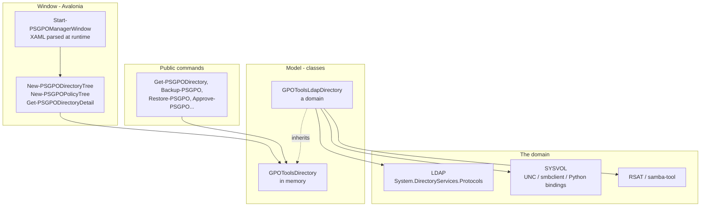

# Architecture

## The repository

```text
Code/
  Classes/            PowerShell classes: the model (GPOs, links, OUs, directory), ADMX,
                      Registry.pol, GptTmpl.inf, preferences, security descriptors, platform
  Functions/Private/  the implementation: LDAP, SYSVOL, backups, workflow, window, trees...
  Functions/Public/   the commands of the module
CI/
  03_Build.ps1        builds the module from Code/
  tests/              the Pester tests (and their fixtures)
HGPM/
  HGPM.psd1           the manifest (FunctionsToExport written by the build)
  HGPM.psm1           built: the classes, then the private and public functions (never edited)
  Resources/          Configuration.psd1, Preferences.json, AvaloniaPackages.json, Icons/
  Avalonia/           Get-AvaloniaBinaries.ps1, and bin/ (the runtime, not committed)
  Samples/            Directory.sample.json (the demonstration environment)
docs/                 this documentation (en, fr, assets)
```

`CI/03_Build.ps1` concatenates the classes and the functions into `HGPM.psm1` and writes the
public functions in the manifest. The module name is always `HGPM`, whatever the folder of
the repository is called.

## Layers



### The model

`GPOToolsDirectory` is a domain in memory: its OUs (`GPOToolsSom`), their links
(`GPOToolsGpoLink`), its GPOs (`GPOToolsGpo`). Its public methods are the operations of the
console (`NewGpo`, `NewLink`, `RemoveLink`, `SetGpoStatus`, `NewFilteringGroups`, `RemoveGpo`,
`RestoreGpo`, `ApproveGpo`, `WritePolicyFile`...): they check what is asked (rights, names,
default GPOs...), then call a hidden `Save*` / `Load*` method that does the work.

- In memory (`Import-PSGPODirectory`, the demonstration environment, the tests), these methods
  keep the changes in memory.
- `GPOToolsLdapDirectory` (`Get-PSGPODirectory`) overrides them to write to the domain.

So the window and the commands are the same code for a domain and for the tests, and a change the
domain refuses leaves the model as it was.

### The platform

`Get-PSGPOPlatform` detects once what the computer is: Windows or Linux, member of a domain or
domain controller (Samba `smb.conf`, `krb5.conf`), its domain, `samba-tool`, the LDAP library.
Each operation then takes the way of its platform:

| Operation | Windows | Linux |
|---|---|---|
| Read the directory | LDAP, the identity of the session | LDAP, Kerberos (SASL GSSAPI) |
| Read and write SYSVOL | UNC path | `smbclient` with Kerberos |
| SYSVOL permissions | .NET access control | Samba Python bindings (`libsmb`) |
| Create and delete GPOs | `New-GPO`, `Remove-GPO` (RSAT) | `samba-tool gpo create / del` |
| Links, status, security filtering, workflow | LDAP | LDAP |

## Principles

- **No password is ever handed to a tool**: Kerberos for `samba-tool` and `smbclient` (never a
  prompt: no standard input, `--use-kerberos=required`), never a password over plain LDAP.
- **The rights are those of the domain**: the console reads the delegations, offers what they
  allow, and lets the domain refuse the rest ([delegation](../features/delegation.md)).
- **No change is lost**: an LDAP value is replaced by removing the old one and adding the new one
  in one request, refused if someone changed it meanwhile; the version of a GPO is increased from
  the value the directory has.
- **Read as data**: the configuration files are read with `Import-PowerShellDataFile`, never run.
- **What the console does not edit is kept**: unknown attributes and item-level targeting of the
  preferences, the extra registry values, the ACEs it does not touch.
