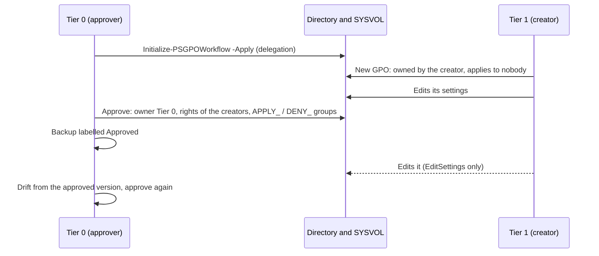

# Approval Tier 0 / Tier 1

Goal: the Tier 1 technicians create the GPOs of their servers; a Tier 0 administrator approves
each one before it applies, and decides whether its creators may still change it.

Everything relies on **the rights of the domain**: the directory and SYSVOL refuse what a
technician may not do, even outside the console. The console only sets these rights, and spares
the technician the actions that would be refused.



## 1. Configure the workflow (Tier 0, once)

In the console, as a domain administrator (the **Settings** button is greyed for the other
accounts), **Settings** opens the configuration of the domain, in
`SYSVOL\<domain>\PSGPOTools\Configuration.psd1`, the same for every console of the domain:

1. In **Setting**, choose `Workflow.Enabled`; in **Value**, `True`; **Set the value**.
2. In **Setting**, choose `Workflow.Creators`; in **Value**, the groups of the creators, separated
   by commas: those of the scripts of the [lab](../getting-started/lab.md), `GPO-Tier1-Admins, GPO-Tier2-Admins`;
   **Set the value**.
3. Keep `Workflow.Approvers` and `Workflow.ApprovedOwner` (`Domain Admins`) or set your Tier 0
   groups, then **Save**.

The settings of the domain show **Set for the domain**, the others **Default**.


The configuration file then holds:

```powershell
@{
    Workflow = @{
        Enabled       = $true
        Approvers     = 'Domain Admins'                       # Tier 0
        Creators      = 'GPO-Tier1-Admins, GPO-Tier2-Admins'  # Tier 1, Tier 2
        ApprovedOwner = 'Domain Admins'
        CreatorRights = 'ReadOnly'                            # what the approval proposes
    }
}
```

The role of an account is read in its groups (`tokenGroups`, nested groups included): an
approver, a creator, or neither. The details of the domain show it. If a group of the workflow
cannot be found, **no GPO can be created** until it is fixed: a GPO of a creator would apply
before its approval.

## 2. Delegate the creation of GPOs (Tier 0, once)

```powershell
Initialize-PSGPOWorkflow -Server dc.hardenbox.labo          # what is there, what is missing
Initialize-PSGPOWorkflow -Server dc.hardenbox.labo -Apply   # adds what is missing
```

The creators get **two rights, and not Group Policy Creator Owners** (which would let them create
GPOs outside the workflow):

| Where | Right | To |
|---|---|---|
| `CN=Policies,CN=System,<domain>` | create `groupPolicyContainer` objects (`f30e3bc2-9ff0-11d1-b603-0000f80367c1`), this object only | each group of creators |
| `\\<dc>\SYSVOL\<domain>\Policies` | list, read and create folders (`0x1200AD`), this folder only | each group of creators |
| the same folder | full control of the folders and files it creates (`OI CI IO`) | CREATOR OWNER |

Run the check again after `samba-tool ntacl sysvolreset`, which gives SYSVOL its default ACL back.

## 3. Create a GPO (Tier 1)

The technician manages only its OUs, the others are greyed ([delegation](../features/delegation.md)),
and the details of the domain say that its GPOs wait for an approval:


It creates the GPO as usual (**Create a GPO in this domain, and Link it here...**); the form says it
will wait, and offers **no security filtering groups**: a GPO filtered on a group would apply to its
members before its approval. They are set at the approval.


What the domain gives it, and what the console adds:

| | Directory (the GPO container) | SYSVOL (its folder and every file in it) |
|---|---|---|
| Owner | the creator | the creator |
| The creator | full control (CREATOR OWNER of the class) | full control |
| Its groups of creators | Edit settings (`0x200B7`) | modify, without delete (`0x1201FF`) |
| Authenticated Users | read, **no "Apply Group Policy"** | read |

**It applies to nobody**, even linked, until it is approved. In the tree it shows
*(waiting for approval)*; its details say who created it.

Its creator owns it while it waits, and the owner of an object can always change its permissions:
with another tool than the console (`ldbmodify`, ADSI), the creator could give "Apply Group Policy"
back to someone. The console then says so, in red: *(waiting for approval, but it applies)* in the
tree, who it applies to in its details and in the approval form. The approval rebuilds its
permissions whatever they are (below). To keep a creator from making a GPO apply by linking it,
give the creators no right to link GPOs (`gPLink`) where they should not apply.

!!! info "Why every file of the folder"
    Samba checks the NT ACL of a file **and** its POSIX ACL, and only changes the POSIX ACL of a
    file for its owner. The rights of the groups of creators are set on every file while the
    creator owns them; they stay there once the GPO is approved.

## 4. Approve it (Tier 0)

The GPOs waiting for approval are found without expanding the tree: **Waiting for approval (N)**,
below **Group Policy Objects**, lists them, expanded when the console opens, and an OU says how many
are linked below it (**Tier 1 (1 waiting for approval)**).


Right click the GPO > **Approve...**:


- **The creators**: *read it only* (they cannot change it anymore), or *keep editing its
  settings* (each change then differs from its approved version);
- **Create the security filtering groups**: the approver creates `APPLY_<GPO>` and `DENY_<GPO>`,
  as the New GPO form does (the prefixes, scope and container of the configuration); the GPO
  applies to the first and is denied to the second. If they cannot be created, the GPO is **not
  approved** and stays pending;
- or **Applies to** / **Denied to**: groups of the domain (Authenticated Users to apply it to
  everyone). When the groups `APPLY_<GPO>` and `DENY_<GPO>` exist already, they are proposed.

```powershell
# Its groups created in the Groups OU of Tier 1
Approve-PSGPO -Server dc.hardenbox.labo -Name 'T1 - Servers - Proxy' -CreateFilteringGroups -GroupContainer 'OU=Groups,OU=Tier 1'
# Groups that exist
Approve-PSGPO -Server dc.hardenbox.labo -Name 'T1 - Servers - Proxy' -ApplyTo 'GG-T1-Proxy-Servers' -DenyTo 'GG-T1-Proxy-Excluded'
```

Without `-ApplyTo` nor `-CreateFilteringGroups`, `Approve-PSGPO` uses the groups `APPLY_<GPO>` and
`DENY_<GPO>` when they exist, else Authenticated Users.

The approval:

1. gives the GPO, the containers it holds (`CN=Machine`, `CN=User`...), its SYSVOL folder and
   **every file and folder in it** to the owner of the approved GPOs: an owner can always change
   the permissions, so the creator would give itself its rights back otherwise;
2. **rebuilds its permissions** from what an approved GPO may hold, not from what the pending GPO
   holds: the allow ACEs of the owners an approved GPO may have (the owner of the approved GPOs,
   the approvers, Domain Admins, Enterprise Admins, Administrators, SYSTEM) and of CREATOR OWNER,
   and the read of Authenticated Users and of the domain controllers. Every other explicit ACE is
   removed: those of the creator and of the groups of creators, and **any other one** (an ACE a
   creator added outside the console, a deny ACE, OWNER RIGHTS). Those last ones are *unexpected*:
   the console, `Approve-PSGPO` (`RemovedPermissions`, and a warning) and the comment of the
   approved backup list them, in SDDL, so that the approver finds out who added them. On Windows,
   each file of the folder loses its explicit ACEs and only inherits the folder;
3. gives the groups of creators of the creator *Edit settings* (EditSettings), or nothing more
   than the reading of everyone (ReadOnly);
4. sets who applies the GPO and who is denied it (a deny ACE for "Apply Group Policy", first in the
   DACL), Authenticated Users keeping the reading;
5. backs it up with the approved label, its comment saying who approved it, who created it, what
   the creators keep, who applies it and who is denied it.

It writes SYSVOL first, then the containers the GPO holds, then **the GPO last**: its owner is
what makes it approved. If one of these writes fails, the GPO is still pending, says so, and can
be approved again once fixed; it is never approved with a SYSVOL folder its creator still owns.


In the lab, the approval of `T1 - Servers - Proxy` with its groups gave:

| | |
|---|---|
| Owner | Domain Admins (the GPO, `CN=Machine`, `CN=User`, the SYSVOL folder and every file) |
| `DENY_T1 - Servers - Proxy` | "Apply Group Policy" denied (first ACE) |
| `APPLY_T1 - Servers - Proxy` | read and "Apply Group Policy"; read and execute on SYSVOL |
| `GPO-Tier1-Admins` | Edit settings (EditSettings) |
| Authenticated Users | read only |
| The two groups | in `OU=Groups,OU=Tier 1`, owned by Domain Admins |

!!! warning "Who manages the members manages the scope"
    Whoever manages the members of `APPLY_<GPO>` decides where the approved GPO applies. The groups
    the approver creates are its own: the Tier 1 technicians cannot add their servers to them. To
    let them choose the servers of their GPOs, delegate the members of these groups (or of their
    OU) to the Tier 1 group, knowingly.

## 5. What a technician can do then

Tested in the lab with the account `tiers1`, outside the console (`smbclient`, LDAP):

| Attempt | ReadOnly | EditSettings |
|---|---|---|
| change a setting (`Registry.pol`) | refused (`NT_STATUS_ACCESS_DENIED`) | **allowed** |
| create a file in the GPO | refused | allowed |
| give itself rights back on the GPO | refused (*no write dacl access*) | refused |
| take ownership of a file | refused (Access Denied) | refused |
| delete the GPO | refused | refused (*insufficient access rights*) |

With EditSettings, each change makes the GPO **differ from its approved version**: the History tab
shows it in orange, `Get-PSGPODrift` lists it, and a Tier 0 approves it again, or restores the
approved version.

## Limits

- While it waits, its creator owns the GPO: with another tool than the console, it can give
  "Apply Group Policy" back to someone, and the GPO applies until it is approved or deleted. The
  console shows it, and the approval removes it; it cannot prevent it, the domain gives every
  owner that right. An ACE for OWNER RIGHTS (`S-1-3-4`) would; it is not set.
- The role of the account is read in its groups: when the server does not say which account the
  console uses (LDAP "Who am I?"), or that account is not found, no GPO can be created until it is
  fixed.
- After an approval with EditSettings, a file a technician creates in the GPO is owned by it: the
  next approval gives it back to the owner of the approved GPOs.
- Approving a GPO again needs it to be pending; to review the changes of an approved GPO, use its
  [drift](drift.md) and approve its backup.
