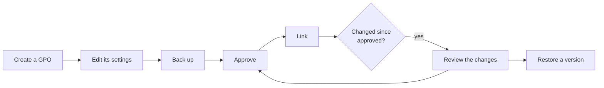

# Workflows

Step-by-step procedures, from the window and from the command line, as they run in the
[lab](../getting-started/lab.md).

| Workflow | For | |
|---|---|---|
| [Create and link a GPO](create-and-link.md) | administrators | a GPO with its status, security filtering groups and link |
| [Back up and restore](backup-and-restore.md) | administrators | a scheduled backup, a comparison, a restore |
| [Recycle bin and templates](recycle-bin-and-templates.md) | administrators | delete, restore a deleted GPO, start from a template |
| [Drift from the approved version](drift.md) | security, audit | find what changed since a version was approved |
| [Approval Tier 0 / Tier 1](approval.md) | Tier 0 and Tier 1 teams | Tier 1 creates, Tier 0 approves, with the rights of the domain |

