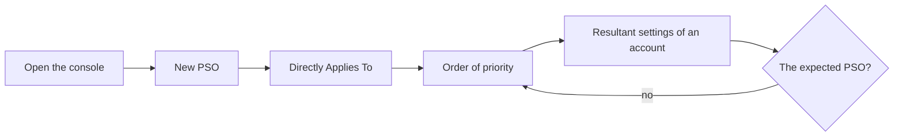

# Password policies of the tiers

Goal: the administrators of the tiers get stronger passwords than the other users, with fine-grained
password policies (PSO), and you check which one applies to each account. As it runs in the
[lab](../getting-started/lab.md): the groups `GPO-Tier1-Admins` (user `tiers1`) and `GPO-Tier2-Admins`
(user `tiers2`) of its scripts, on the Samba AD domain `hardenbox.labo`.

| PSO | Precedence | Applies to | Settings |
|---|---|---|---|
| PSO - Tier 1 Admins | 10 | `GPO-Tier1-Admins` | 16 characters, expires after 180 days, locked out 30 minutes after 10 attempts |
| PSO - Tier 2 Admins | 20 | `GPO-Tier2-Admins` | 14 characters, expires after 90 days, locked out until unlocked after 10 attempts |
| PSO - Domain Users | 50 | `Domain Users` | 12 characters, history 12 |

`tiers1` is in `GPO-Tier1-Admins` and in `Domain Users` (its primary group): two PSOs concern it, the
one of precedence 10 applies.



## 1. Open the console

An administrator of the domain (by default, only they read and change the PSOs):

```powershell
kinit administrator@HARDENBOX.LABO     # Linux; Windows: the session of the administrator
Show-PSOManagerAvalonia -Server dc.hardenbox.labo
```

The domain has no PSO yet: every user gets the **default domain password policy**, shown under the
list.


## 2. Create the PSO of Tier 1

**New...** opens the window of a new PSO, with the settings of the Administrative Center (7
characters, 24 passwords remembered, complexity, 1 day minimum and 42 days maximum age, protected
from accidental deletion):

1. **Name** `PSO - Tier 1 Admins`, **Precedence** `10`.
2. **Minimum password length** `16`.
3. **User must change the password after (days)** `180`.
4. Check **Enforce account lockout policy**: `10` failed attempts, reset after `30` minutes, locked
   out `30` minutes.
5. **Description** `Administrators of the servers (Tier 1)`.


Under **Directly Applies To**, search `GPO-Tier`, select `GPO-Tier1-Admins`, **Add**: the PSO applies
to the members of the group. The window says which groups pass a PSO on: on Samba AD, every security
group but the built-in ones; on Windows, the global security groups only.

!!! warning "Samba AD and Windows do not apply the same PSO"
    A PSO applied to a **domain local** or **universal** security group applies to its members on
    a **Samba AD** domain, and to **nobody** on a **Windows** domain. The same groups and the same
    PSOs can then give another password policy to the same user, for instance after a migration
    from Samba AD to Windows, or with Windows and Samba domain controllers side by side.

    - Apply the PSOs to users, or to **global security groups**: both domain controllers pass them on.
    - Check the result in **Resultant Password Settings**: the PSO in the frame is the one the domain
      controller you read applies; a PSO **Ignored** reaches the account through a group that does
      not pass it on there.


**OK** checks the settings, creates the PSO and selects it in the list.

## 3. The other PSOs, from the command line

The same, with the commands of the module:

```powershell
$Server = 'dc.hardenbox.labo'
New-PSGPOFineGrainedPasswordPolicy -Server $Server -Name 'PSO - Tier 2 Admins' -Precedence 20 `
    -MinPasswordLength 14 -MaxPasswordAge 90.00:00:00 -LockoutThreshold 10 -LockoutDuration 0 `
    -AppliesTo 'GPO-Tier2-Admins' -Description 'Administrators of the workstations (Tier 2)'
New-PSGPOFineGrainedPasswordPolicy -Server $Server -Name 'PSO - Domain Users' -Precedence 50 `
    -MinPasswordLength 12 -PasswordHistoryCount 12 -AppliesTo 'Domain Users' `
    -Description 'Every user of the domain' -ProtectedFromAccidentalDeletion $false
```

`-LockoutDuration 0`: locked out until an administrator unlocks the account. **Refresh** (F5) shows
them in the console, by order of priority:


**Properties...** opens a PSO again; OK without a change changes nothing.


## 4. Which PSO applies to tiers1?

**Resultant Password Settings**, search `tiers`, select `Tiers1`:


- **PSO - Tier 1 Admins** applies, through `GPO-Tier1-Admins`: precedence 10.
- **PSO - Domain Users** concerns it too, through its primary group, but comes after (precedence 50).
- The **default domain password policy** does not apply: a PSO does.

The PSO in the frame is the answer of the domain controller (`msDS-ResultantPSO`); the order of the
list is the one of the rules, and the console says it if they ever differ.

Selected, a group shows what its members get through it:


From the command line:

```powershell
Get-PSGPOResultantPasswordPolicy -Server dc.hardenbox.labo -Identity tiers1 |
    Select-Object -ExpandProperty Candidates | Format-Table Order, Name, Precedence, AppliesThrough, Status, Reason
```

## 5. Change, then delete

Raising the precedence of `PSO - Domain Users` to 5 would apply it to `tiers1` too: the resultant
view shows it at once, before anything else changes in the domain. To delete a PSO, **Delete**; one
protected from accidental deletion is kept:


Uncheck **Protect from accidental deletion** in its properties first, or:

```powershell
Set-PSGPOFineGrainedPasswordPolicy -Server dc.hardenbox.labo -Name 'PSO - Tier 1 Admins' -ProtectedFromAccidentalDeletion $false
Remove-PSGPOFineGrainedPasswordPolicy -Server dc.hardenbox.labo -Name 'PSO - Tier 1 Admins'
```

Every change is in the audit log of HGPM:

```powershell
Get-PSGPOAuditLog -Action '*PasswordPolicy' | Format-Table Time, Account, Action, Target
```
