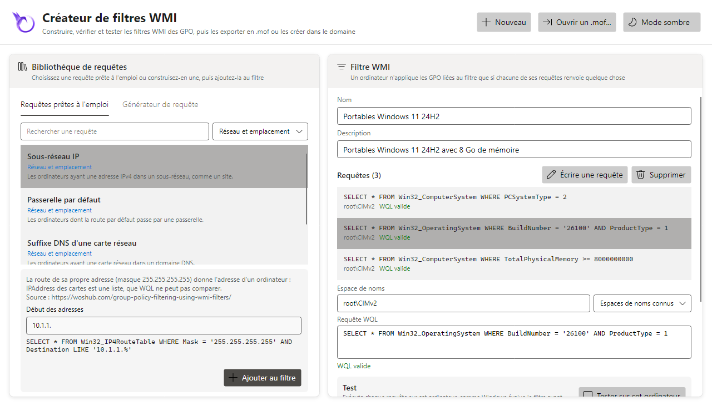
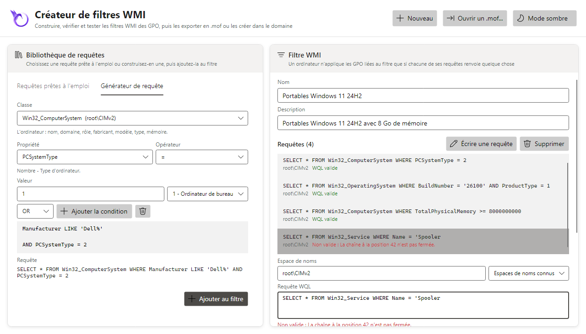

# Créateur de filtres WMI

`Show-WmiFilterCreatorAvalonia` (ou la tuile **Créateur de filtres WMI** de `Start-HGPM`) écrit les
filtres WMI des GPO : à partir de requêtes prêtes à l'emploi ou d'un générateur de requête, chaque
requête vérifiée à la saisie, le filtre testé sur l'ordinateur, puis exporté en fichier `.mof` au
format de la GPMC ou créé dans le domaine. Écrire, vérifier et exporter un filtre ne demande aucun
domaine, sous Windows comme sous Linux.

```powershell
Show-WmiFilterCreatorAvalonia
Show-WmiFilterCreatorAvalonia -Path C:\Exports\Workstations.mof     # un .mof de la GPMC ou de HGPM
Show-WmiFilterCreatorAvalonia -Server dc.contoso.com -Language fr-FR
```



Un filtre WMI est **vrai quand chacune de ses requêtes renvoie au moins une instance** sur
l'ordinateur qui applique la GPO ([Filtres WMI et clients Linux](wmi-filters-and-linux.md)) : les
requêtes du filtre sont jointes par ET, un OU s'écrit dans une seule requête.

## Requêtes prêtes à l'emploi

La bibliothèque contient plus de soixante requêtes, par catégorie, chacune avec ses pièges et sa
source (Microsoft Learn d'abord, puis la communauté : woshub, le blog *Ask the Directory Services
Team*, la PowerShell Gallery) :

| Catégorie | Requêtes |
|---|---|
| Système d'exploitation | postes de travail, serveurs membres, contrôleurs de domaine, serveurs, tous sauf les contrôleurs de domaine, Windows 10, Windows 11, une version de Windows 11 (21H2 à 26H2), une version de Windows Server (2016 à 2025), un build minimal, Windows antérieurs à Windows 10 |
| Édition et langue | édition (SKU), Server Core, 64 bits, 32 bits, processeur ARM64, langue de l'installation |
| Domaine et nom | membres d'un domaine, ordinateurs d'un domaine, nom de l'ordinateur (modèle), émulateur PDC |
| Matériel | portables, ordinateurs de bureau, une batterie, fabricant, modèle, mémoire minimale, espace libre sur un lecteur, cœurs de processeur, fabricant du processeur, microprogramme UEFI |
| Machines virtuelles | hyperviseur présent, Hyper-V ou Azure, Azure, VMware, VirtualBox, KVM/QEMU/Proxmox, Nutanix AHV, Xen, Amazon EC2, ordinateurs physiques |
| Sécurité | TPM activé, TPM 2.0, BitLocker activé ou non sur un lecteur, sécurité basée sur la virtualisation, stratégie d'intégrité du code appliquée, antivirus inscrit |
| Réseau et emplacement | sous-réseau IP, passerelle par défaut, suffixe DNS d'une carte réseau, fuseau horaire |
| Logiciels et services | programme installé, programme MSI installé (lent), service installé ou en cours d'exécution, mise à jour installée, fonctionnalité facultative, rôle de Windows Server, variable d'environnement |
| Fichiers | le fichier existe, version minimale d'un fichier, le dossier existe |
| Heure et état | jours ouvrés, heures de la journée, démarrage normal |

Une requête à paramètres (un build, une mémoire en Go, un sous-réseau, un chemin...) les affiche
sous sa note : la requête s'écrit à la saisie, une valeur incorrecte dit pourquoi. **Ajouter au
filtre** (ou un double-clic) l'ajoute ; la première requête ajoutée nomme un filtre sans nom.

Les mêmes requêtes sont une commande, pour les scripts :

```powershell
Get-PSGPOWmiQueryTemplate | Format-Table Category, Id, Query
$Query = Get-PSGPOWmiQueryTemplate -Id Memory -Value @{ Memory = 16 }
New-PSGPOWmiFilter -Name '16 Go' -Query $Query.Query -Namespace $Query.Namespace
```

## Générateur de requête

L'onglet **Générateur de requête** écrit une requête à partir d'une classe du catalogue (25 classes
dans leur espace de noms : `Win32_OperatingSystem`, `Win32_ComputerSystem`, `Win32_Tpm`,
`Win32_EncryptableVolume`, `Win32_DeviceGuard`...) : une propriété, ses valeurs connues (type de
produit, type de PC, rôle dans le domaine, SKU, langue...), un opérateur (`=`, `<>`, `<`, `>`,
`LIKE`, `NOT LIKE`, `IS NULL`...) et une valeur. Un texte est mis entre guillemets et échappé, un
nombre vérifié, un booléen écrit `TRUE` ou `FALSE` ; les conditions sont jointes par AND ou OR.



## Vérification des requêtes

Chaque requête du filtre est vérifiée à la saisie, sans WMI (sous Linux aussi) : `SELECT`, `FROM`
une classe, des conditions `WHERE` qui comparent une propriété à une valeur, jointes par `AND`,
`OR`, `NOT` et des parenthèses. Une requête non valide dit où (*La chaîne à la position 42 n'est
pas fermée*) ; le filtre n'est exporté ou créé que si chaque requête est valide. Un avertissement
accompagne une classe d'un autre espace de noms que celui de la requête, et les classes coûteuses :
`Win32_Product` (elle vérifie et répare chaque programme MSI à chaque lecture), `CIM_DataFile` lue
autrement que par son nom complet, `root\SecurityCenter2` (absent de Windows Server).

## Tester sur cet ordinateur

**Tester sur cet ordinateur** (Windows) exécute chaque requête comme Windows évalue le filtre avant
d'appliquer une GPO, sans bloquer la fenêtre : chaque requête est Vraie (elle renvoie quelque
chose) ou Fausse (elle ne renvoie rien, ou échoue : une classe ou un espace de noms que
l'ordinateur n'a pas), et le filtre est Vrai si chaque requête l'est. Les classes du TPM et de
BitLocker demandent une session élevée, puisque le système évalue les GPO.

`Test-PSGPOWmiFilter` fait de même en ligne de commande, sur cet ordinateur ou un autre (CIM,
WinRM) :

```powershell
Test-PSGPOWmiFilter -Query 'SELECT * FROM Win32_OperatingSystem WHERE ProductType = 1'
Get-PSGPOWmiFilter -Name 'Windows 11' | Test-PSGPOWmiFilter -ComputerName PC042
Test-PSGPOWmiFilter -Path C:\Exports\Workstations.mof
```

## Exporter, ouvrir, créer

- **Exporter en .mof** écrit le filtre au format de la GPMC (UTF-16, `MSFT_SomFilter`), par défaut
  dans le dossier Documents, au nom du filtre ; un fichier existant est remplacé après
  confirmation. **Importer...** sur *Filtres WMI* le crée dans un domaine, dans la GPMC comme dans
  HGPM (`Import-PSGPOWmiFilter`).
- **Ouvrir un .mof...** ouvre un filtre exporté par la GPMC ou HGPM, pour le modifier ou partir de
  lui.
- **Créer dans le domaine** crée le filtre comme *Nouveau...* sur *Filtres WMI*, avec les droits du
  compte (`-Server`, `-Credential`, sinon le domaine de l'ordinateur, lu à la première création).
  Liez-lui ensuite une GPO dans Gestion de stratégie de groupe.

`Export-PSGPOWmiFilter -InputObject` exporte un filtre écrit sans domaine :

```powershell
$Queries = Get-PSGPOWmiQueryTemplate -Id Laptops, Windows11
[pscustomobject]@{ Name = 'Portables Windows 11'; Queries = $Queries } | Export-PSGPOWmiFilter -Path C:\Exports
```

## Bonnes pratiques

- Gardez des requêtes peu coûteuses : le filtre s'exécute à chaque actualisation de la stratégie de
  groupe, pour l'ordinateur et l'utilisateur, et un filtre qui ne répond pas en 30 secondes est
  faux.
- Préférez une OU à un filtre WMI quand les ordinateurs peuvent y être placés : une OU ne coûte
  rien.
- `BuildNumber` et `Version` sont des textes : comparez des builds à cinq chiffres, et gardez
  `Version LIKE '10.0%'` avant une comparaison ; Windows Server 2025 et Windows 11 24H2 partagent le
  build 26100, `ProductType` les distingue.
- `IPAddress` des cartes réseau est une liste, que WQL ne peut pas comparer : la requête de
  sous-réseau lit la route de l'adresse de l'ordinateur (`Win32_IP4RouteTable`).
- Testez le filtre sur un ordinateur de chaque type qu'il vise, et sur un qu'il ne doit pas viser.
- Un client Linux joint avec Samba n'évalue pas les filtres WMI : ciblez-le par son OU
  ([Filtres WMI et clients Linux](wmi-filters-and-linux.md)).
