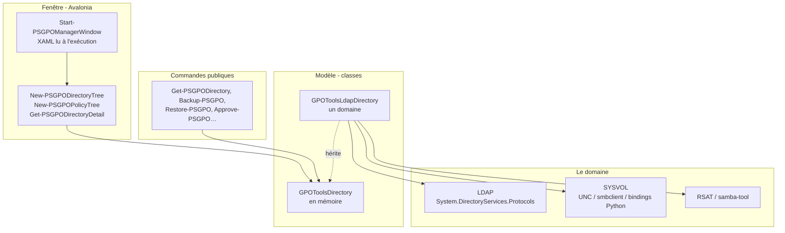

# Architecture

## Le dépôt

```text
Code/
  Classes/            classes PowerShell : le modèle (GPO, liens, OU, annuaire), ADMX,
                      Registry.pol, GptTmpl.inf, préférences, descripteurs de sécurité, plateforme
  Functions/Private/  l'implémentation : LDAP, SYSVOL, sauvegardes, workflow, fenêtre, arbres…
  Functions/Public/   les commandes du module
CI/
  03_Build.ps1        construit le module depuis Code/
  tests/              les tests Pester (et leurs fixtures)
PSGPOTools/
  PSGPOTools.psd1     le manifest (FunctionsToExport écrit par le build)
  PSGPOTools.psm1     construit : les classes, puis les fonctions privées et publiques (jamais modifié à la main)
  Resources/          Configuration.psd1, Preferences.json, AvaloniaPackages.json, Icons/
  Avalonia/           Get-AvaloniaBinaries.ps1, et bin/ (le runtime, non versionné)
  Samples/            Directory.sample.json (l'environnement de démonstration)
docs/                 cette documentation (en, fr, assets)
```

`CI/03_Build.ps1` concatène les classes et les fonctions dans `PSGPOTools.psm1` et écrit les
fonctions publiques dans le manifest. Le module s'appelle toujours `PSGPOTools`, quel que soit le
nom du dossier du dépôt.

## Les couches



### Le modèle

`GPOToolsDirectory` est un domaine en mémoire : ses OU (`GPOToolsSom`), leurs liens
(`GPOToolsGpoLink`), ses GPO (`GPOToolsGpo`). Ses méthodes publiques sont les opérations de la
console (`NewGpo`, `NewLink`, `RemoveLink`, `SetGpoStatus`, `NewFilteringGroups`, `RemoveGpo`,
`RestoreGpo`, `ApproveGpo`, `WritePolicyFile`…) : elles vérifient la demande (droits, noms, GPO par
défaut…), puis appellent une méthode cachée `Save*` / `Load*` qui fait le travail.

- En mémoire (`Import-PSGPODirectory`, l'environnement de démonstration, les tests), ces méthodes
  gardent les modifications en mémoire.
- `GPOToolsLdapDirectory` (`Get-PSGPODirectory`) les redéfinit pour écrire dans le domaine.

La fenêtre et les commandes sont donc le même code pour un domaine et pour les tests, et une
modification refusée par le domaine laisse le modèle tel qu'il était.

### La plateforme

`Get-PSGPOPlatform` détecte une fois ce qu'est l'ordinateur : Windows ou Linux, membre d'un
domaine ou contrôleur de domaine (`smb.conf` de Samba, `krb5.conf`), son domaine, `samba-tool`, la
bibliothèque LDAP. Chaque opération prend ensuite le chemin de sa plateforme :

| Opération | Windows | Linux |
|---|---|---|
| Lire l'annuaire | LDAP, l'identité de la session | LDAP, Kerberos (SASL GSSAPI) |
| Lire et écrire SYSVOL | chemin UNC | `smbclient` avec Kerberos |
| Droits SYSVOL | contrôle d'accès .NET | bindings Python de Samba (`libsmb`) |
| Créer et supprimer des GPO | `New-GPO`, `Remove-GPO` (RSAT) | `samba-tool gpo create / del` |
| Liens, statut, filtrage de sécurité, workflow | LDAP | LDAP |

## Principes

- **Aucun mot de passe n'est jamais donné à un outil** : Kerberos pour `samba-tool` et `smbclient`
  (jamais d'invite : pas d'entrée standard, `--use-kerberos=required`), jamais de mot de passe en
  LDAP en clair.
- **Les droits sont ceux du domaine** : la console lit les délégations, propose ce qu'elles
  permettent, et laisse le domaine refuser le reste ([délégation](../features/delegation.md)).
- **Aucune modification n'est perdue** : une valeur LDAP est remplacée en retirant l'ancienne et en
  ajoutant la nouvelle dans une seule requête, refusée si quelqu'un l'a changée entre-temps ; la
  version d'une GPO est augmentée à partir de celle que l'annuaire contient.
- **Lus comme des données** : les fichiers de configuration sont lus avec
  `Import-PowerShellDataFile`, jamais exécutés.
- **Ce que la console ne modifie pas est conservé** : attributs inconnus et ciblage des
  préférences, valeurs de registre en plus, ACE qu'elle ne touche pas.
