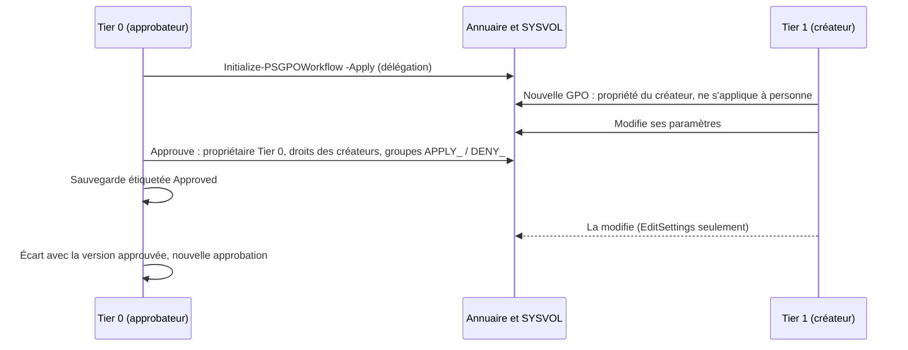

# Approbation Tier 0 / Tier 1

Objectif : les techniciens Tier 1 créent les GPO de leurs serveurs ; un administrateur Tier 0
approuve chacune avant qu'elle s'applique, et décide si ses créateurs peuvent encore la modifier.

Tout repose sur **les droits du domaine** : l'annuaire et SYSVOL refusent ce qu'un technicien n'a
pas le droit de faire, même en dehors de la console. La console ne fait que poser ces droits, et
évite au technicien les actions qui lui seraient refusées.



## 1. Configurer le workflow (Tier 0, une fois)

Dans la console, en administrateur du domaine (le bouton **Paramètres** est grisé pour les autres
comptes), **Paramètres** ouvre la configuration du domaine, dans
`SYSVOL\<domaine>\PSGPOTools\Configuration.psd1`, la même pour toutes les consoles du domaine :

1. Dans **Paramètre**, choisissez `Workflow.Enabled` ; dans **Valeur**, `True` ; **Définir la valeur**.
2. Dans **Paramètre**, choisissez `Workflow.Creators` ; dans **Valeur**, les groupes des créateurs,
   séparés par des virgules : ceux des scripts du [labo](../getting-started/lab.md),
   `GPO-Tier1-Admins, GPO-Tier2-Admins` ; **Définir la valeur**.
3. Gardez `Workflow.Approvers` et `Workflow.ApprovedOwner` (`Domain Admins`) ou mettez vos groupes
   Tier 0, puis **Enregistrer**.

Les paramètres du domaine affichent **Défini pour le domaine**, les autres **Par défaut**.


Le fichier de configuration contient alors :

```powershell
@{
    Workflow = @{
        Enabled       = $true
        Approvers     = 'Domain Admins'                       # Tier 0
        Creators      = 'GPO-Tier1-Admins, GPO-Tier2-Admins'  # Tier 1, Tier 2
        ApprovedOwner = 'Domain Admins'
        CreatorRights = 'ReadOnly'                            # ce que l'approbation propose
    }
}
```

Le rôle d'un compte est lu dans ses groupes (`tokenGroups`, groupes imbriqués compris) :
approbateur, créateur, ou aucun des deux. Les détails du domaine l'affichent. Si un groupe du
workflow est introuvable, **aucune GPO ne peut être créée** tant que ce n'est pas corrigé : une GPO
d'un créateur s'appliquerait avant son approbation.

## 2. Déléguer la création de GPO (Tier 0, une fois)

```powershell
Initialize-PSGPOWorkflow -Server dc.hardenbox.labo          # ce qui est en place, ce qui manque
Initialize-PSGPOWorkflow -Server dc.hardenbox.labo -Apply   # ajoute ce qui manque
```

Les créateurs reçoivent **deux droits, et pas Group Policy Creator Owners** (qui leur permettrait de
créer des GPO hors du workflow) :

| Où | Droit | À |
|---|---|---|
| `CN=Policies,CN=System,<domaine>` | créer des objets `groupPolicyContainer` (`f30e3bc2-9ff0-11d1-b603-0000f80367c1`), cet objet seulement | chaque groupe de créateurs |
| `\\<dc>\SYSVOL\<domaine>\Policies` | lister, lire et créer des dossiers (`0x1200AD`), ce dossier seulement | chaque groupe de créateurs |
| le même dossier | contrôle total des dossiers et fichiers qu'il crée (`OI CI IO`) | CREATOR OWNER |

Relancez la vérification après `samba-tool ntacl sysvolreset`, qui remet les ACL par défaut de
SYSVOL.

## 3. Créer une GPO (Tier 1)

Le technicien ne gère que ses OU, les autres sont grisées ([délégation](../features/delegation.md)),
et les détails du domaine disent que ses GPO attendent une approbation :


Il crée la GPO comme d'habitude (**Create a GPO in this domain, and Link it here...**) ; le
formulaire dit qu'elle attendra, et ne propose **pas de groupes de filtrage** : une GPO filtrée sur
un groupe s'appliquerait à ses membres avant son approbation. Ils sont posés à l'approbation.


Ce que le domaine lui donne, et ce que la console ajoute :

| | Annuaire (le conteneur de la GPO) | SYSVOL (son dossier et chaque fichier) |
|---|---|---|
| Propriétaire | le créateur | le créateur |
| Le créateur | contrôle total (CREATOR OWNER de la classe) | contrôle total |
| Ses groupes de créateurs | Edit settings (`0x200B7`) | modifier, sans supprimer (`0x1201FF`) |
| Authenticated Users | lecture, **sans « Appliquer la stratégie de groupe »** | lecture |

**Elle ne s'applique à personne**, même liée, tant qu'elle n'est pas approuvée. Dans l'arbre, elle
affiche *(waiting for approval)* ; ses détails disent qui l'a créée.

Son créateur en est propriétaire tant qu'elle attend, et le propriétaire d'un objet peut toujours
en changer les droits : avec un autre outil que la console (`ldbmodify`, ADSI), le créateur
pourrait redonner « Appliquer la stratégie de groupe » à quelqu'un. La console le dit alors, en
rouge : *(waiting for approval, but it applies)* dans l'arbre, à qui elle s'applique dans ses
détails et dans le formulaire d'approbation. L'approbation reconstruit ses droits quels qu'ils
soient (ci-dessous). Pour qu'un créateur ne puisse pas faire appliquer une GPO en la liant, ne lui
donnez pas le droit de lier des GPO (`gPLink`) là où elles ne doivent pas s'appliquer.

!!! info "Pourquoi chaque fichier du dossier"
    Samba vérifie l'ACL NT d'un fichier **et** son ACL POSIX, et ne modifie l'ACL POSIX d'un
    fichier que pour son propriétaire. Les droits des groupes de créateurs sont posés sur chaque
    fichier tant que le créateur en est propriétaire ; ils y restent une fois la GPO approuvée.

## 4. L'approuver (Tier 0)

Les GPO en attente d'approbation se trouvent sans déplier l'arbre : **En attente d'approbation (N)**,
sous **Objets de stratégie de groupe**, les liste, déplié à l'ouverture de la console, et une UO dit
combien sont liées en dessous (**Tier 1 (1 en attente d'approbation)**).


Clic droit sur la GPO > **Approve...** :


- **The creators** : *la lire seulement* (ils ne peuvent plus la modifier), ou *continuer à modifier
  ses paramètres* (chaque modification la fait alors s'écarter de sa version approuvée) ;
- **Create the security filtering groups** : l'approbateur crée `APPLY_<GPO>` et `DENY_<GPO>`,
  comme le formulaire New GPO (préfixes, étendue et conteneur de la configuration) ; la GPO
  s'applique au premier et est refusée au second. S'ils ne peuvent pas être créés, la GPO **n'est
  pas approuvée** et reste en attente ;
- ou **Applies to** / **Denied to** : des groupes du domaine (Authenticated Users pour l'appliquer à
  tous). Quand les groupes `APPLY_<GPO>` et `DENY_<GPO>` existent déjà, ils sont proposés.

```powershell
# Ses groupes créés dans l'OU Groups du Tier 1
Approve-PSGPO -Server dc.hardenbox.labo -Name 'T1 - Servers - Proxy' -CreateFilteringGroups -GroupContainer 'OU=Groups,OU=Tier 1'
# Des groupes qui existent
Approve-PSGPO -Server dc.hardenbox.labo -Name 'T1 - Servers - Proxy' -ApplyTo 'GG-T1-Proxy-Servers' -DenyTo 'GG-T1-Proxy-Excluded'
```

Sans `-ApplyTo` ni `-CreateFilteringGroups`, `Approve-PSGPO` utilise les groupes `APPLY_<GPO>` et
`DENY_<GPO>` s'ils existent, sinon Authenticated Users.

L'approbation :

1. donne la GPO, les conteneurs qu'elle contient (`CN=Machine`, `CN=User`…), son dossier SYSVOL et
   **chaque fichier et dossier qu'il contient** au propriétaire des GPO approuvées : un
   propriétaire peut toujours changer les droits, le créateur se rendrait donc ses droits sinon ;
2. **reconstruit ses droits** à partir de ce qu'une GPO approuvée peut avoir, et non de ce qu'a la
   GPO en attente : les ACE d'autorisation des propriétaires possibles d'une GPO approuvée (le
   propriétaire des GPO approuvées, les approbateurs, Domain Admins, Enterprise Admins,
   Administrators, SYSTEM) et de CREATOR OWNER, et la lecture d'Authenticated Users et des
   contrôleurs de domaine. Toute autre ACE explicite est retirée : celles du créateur et des
   groupes de créateurs, et **toute autre** (une ACE ajoutée par un créateur hors de la console,
   une ACE de refus, OWNER RIGHTS). Ces dernières sont *inattendues* : la console, `Approve-PSGPO`
   (`RemovedPermissions`, et un avertissement) et le commentaire de la sauvegarde approuvée les
   listent, en SDDL, pour que l'approbateur cherche qui les a ajoutées. Sous Windows, chaque
   fichier du dossier perd ses ACE explicites et hérite seulement du dossier ;
3. donne aux groupes de créateurs du créateur *Edit settings* (EditSettings), ou rien de plus que
   la lecture de tous (ReadOnly) ;
4. pose qui applique la GPO et à qui elle est refusée (une ACE de refus de « Appliquer la stratégie
   de groupe », en tête de la DACL), Authenticated Users gardant la lecture ;
5. la sauvegarde avec l'étiquette approuvée, son commentaire disant qui l'a approuvée, qui l'a
   créée, ce que gardent les créateurs, qui l'applique et à qui elle est refusée.

Elle écrit SYSVOL d'abord, puis les conteneurs que contient la GPO, puis **la GPO en dernier** :
c'est son propriétaire qui la rend approuvée. Si l'une de ces écritures échoue, la GPO est encore
en attente, la console le dit, et elle peut être approuvée de nouveau une fois le problème corrigé ;
elle n'est jamais approuvée avec un dossier SYSVOL que son créateur possède encore.


Dans le labo, l'approbation de `T1 - Servers - Proxy` avec ses groupes a donné :

| | |
|---|---|
| Propriétaire | Domain Admins (la GPO, `CN=Machine`, `CN=User`, le dossier SYSVOL et chaque fichier) |
| `DENY_T1 - Servers - Proxy` | « Appliquer la stratégie de groupe » refusé (première ACE) |
| `APPLY_T1 - Servers - Proxy` | lecture et « Appliquer la stratégie de groupe » ; lecture et exécution sur SYSVOL |
| `GPO-Tier1-Admins` | Edit settings (EditSettings) |
| Authenticated Users | lecture seule |
| Les deux groupes | dans `OU=Groups,OU=Tier 1`, propriété de Domain Admins |

!!! warning "Qui gère les membres gère la portée"
    Celui qui gère les membres d'`APPLY_<GPO>` décide où s'applique la GPO approuvée. Les groupes
    que crée l'approbateur lui appartiennent : les techniciens Tier 1 ne peuvent pas y ajouter leurs
    serveurs. Pour les laisser choisir les serveurs de leurs GPO, déléguez les membres de ces
    groupes (ou de leur OU) au groupe Tier 1, en connaissance de cause.

## 5. Ce qu'un technicien peut faire ensuite

Testé dans le labo avec le compte `tiers1`, hors de la console (`smbclient`, LDAP) :

| Tentative | ReadOnly | EditSettings |
|---|---|---|
| modifier un paramètre (`Registry.pol`) | refusé (`NT_STATUS_ACCESS_DENIED`) | **autorisé** |
| créer un fichier dans la GPO | refusé | autorisé |
| se redonner des droits sur la GPO | refusé (*no write dacl access*) | refusé |
| prendre la propriété d'un fichier | refusé (Access Denied) | refusé |
| supprimer la GPO | refusé | refusé (*insufficient access rights*) |

Avec EditSettings, chaque modification fait **s'écarter la GPO de sa version approuvée** : l'onglet
History l'affiche en orange, `Get-PSGPODrift` la liste, et un Tier 0 l'approuve de nouveau, ou
restaure la version approuvée.

## Limites

- Tant qu'elle attend, son créateur est propriétaire de la GPO : avec un autre outil que la
  console, il peut redonner « Appliquer la stratégie de groupe » à quelqu'un, et la GPO s'applique
  jusqu'à son approbation ou sa suppression. La console le montre et l'approbation le retire ; elle
  ne peut pas l'empêcher, le domaine donne ce droit à tout propriétaire. Une ACE pour OWNER RIGHTS
  (`S-1-3-4`) l'en empêcherait ; elle n'est pas posée.
- Le rôle du compte est lu dans ses groupes : quand le serveur ne dit pas quel compte la console
  utilise (LDAP « Who am I? »), ou que ce compte est introuvable, aucune GPO ne peut être créée
  tant que ce n'est pas corrigé.
- Après une approbation en EditSettings, un fichier qu'un technicien crée dans la GPO lui
  appartient : l'approbation suivante le rend au propriétaire des GPO approuvées.
- Approuver une GPO de nouveau demande qu'elle soit en attente ; pour revoir les modifications
  d'une GPO approuvée, utilisez son [écart](drift.md) et approuvez sa sauvegarde.
