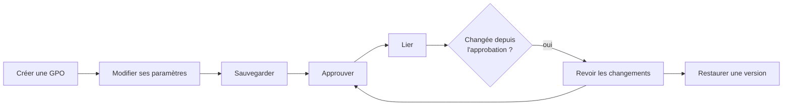

# Workflows

Des procédures pas à pas, depuis la fenêtre et en ligne de commande, telles qu'elles se déroulent
dans le [labo](../getting-started/lab.md).

| Workflow | Pour | |
|---|---|---|
| [Créer et lier une GPO](create-and-link.md) | administrateurs | une GPO avec son statut, ses groupes de filtrage et son lien |
| [Sauvegarder et restaurer](backup-and-restore.md) | administrateurs | une sauvegarde planifiée, une comparaison, une restauration |
| [Corbeille et modèles](recycle-bin-and-templates.md) | administrateurs | supprimer, restaurer une GPO supprimée, partir d'un modèle |
| [Écart avec la version approuvée](drift.md) | sécurité, audit | trouver ce qui a changé depuis l'approbation d'une version |
| [Approbation Tier 0 / Tier 1](approval.md) | équipes Tier 0 et Tier 1 | le Tier 1 crée, le Tier 0 approuve, avec les droits du domaine |

